# Stress Prediction: Synthetic Dataset & ML Research Pipeline

> A student-friendly research project for exploring stress-label classification from wearable-style signals and self-reported measures. It uses clear diagrams, interactive charts, and concise explanations so you can follow—and present—each step of the workflow.

**Important:** The included dataset is synthetic. This repository is for learning and experimentation, not medical use. Model scores on generated data do not establish clinical accuracy or real-world performance.

## Start here

| If you want to… | Open… |
|---|---|
| Understand and reproduce the research workflow | [`finally.ipynb`](./finally.ipynb) |
| Inspect the ready-to-use 600-row dataset | [`synthetic_stress_predict_600_participants.csv`](./synthetic_stress_predict_600_participants.csv) |
| Explore the bundled raw-data archive | [`synthetic_stress_predict_raw_data_S001_S600.zip`](./synthetic_stress_predict_raw_data_S001_S600.zip) |
| Review supplementary dashboard and clinical-report code | [`live preview and download clinical pdfs reports`](./live%20preview%20and%20download%20clinical%20pdfs%20reports) |

## Project at a glance

- **Task:** Binary classification of a synthetic stress label (`0` = Normal/Baseline, `1` = Stressed).
- **Dataset:** 600 records and 17 columns, including physiological measurements, questionnaire scores, demographics, and metadata.
- **Main idea:** Compare resting HR/RR baselines with task measurements, then evaluate whether baseline-relative features help separate the two labels.
- **Research workflow:** Data checks → feature engineering → model evaluation → visual comparison → report generation.
- **Learning level:** Suitable for students who know basic Python and want to study a full tabular-ML project.

## How the workflow fits together

```mermaid
flowchart LR
    A[CSV: 600 synthetic records] --> B[Inspect columns and labels]
    B --> C[Clean values and audit missingness / outliers]
    C --> D[Create baseline-relative features]
    D --> E[Split data and run stratified validation]
    E --> F[Compare and tune classifiers]
    F --> G[Review metrics, plots, and cohort checks]
    G --> H[Export tables, figures, and reports]
```



### In plain language

1. **Load and inspect:** Read the CSV, identify the target and measurements, and check data quality.
2. **Prepare features:** Compare task responses with resting measurements. For example, `ΔInterview HR = Interview HR − Resting HR`.
3. **Train fairly:** Use stratified train/test splits and cross-validation so class proportions are maintained across folds.
4. **Compare models:** The notebook evaluates several classifiers and includes tuned models and ensemble comparisons.
5. **Explain results:** Review accuracy, precision, recall, F1, ROC-AUC, confusion matrices, feature importance, and ablation results—not accuracy alone.
6. **Create visuals and reports:** Generate research figures and report-oriented outputs to help explain the analysis.

## Dataset guide

The main CSV has **600 rows × 17 columns**. Each row represents one synthetic participant record. The values are generated for demonstration; they are not measurements collected from real people.

| Column | Meaning |
|---|---|
| `Participant_ID` | Synthetic participant identifier |
| `Assigned Name` | Generated name/group label; not a real identity |
| `Age` | Age value in the generated record |
| `Gender` | Generated gender category |
| `PSS Score (0-40)` | Perceived Stress Scale-style score |
| `STAI-State (20-80)` | State anxiety-style score |
| `STAI-Trait (20-80)` | Trait anxiety-style score |
| `HR` | Resting heart rate, beats per minute (bpm) |
| `Stroop HR (bpm)` | Heart rate during the Stroop task |
| `Interview HR (bpm)` | Heart rate during the interview task |
| `Hyperventilation HR (bpm)` | Heart rate during the hyperventilation task |
| `RR` | Resting respiratory rate |
| `Stress Resp Rate (brpm)` | Respiratory rate during a stress/task condition |
| `Mean EDA (μS)` | Mean electrodermal activity (microsiemens) |
| `Skin Temp (°C)` | Skin temperature in degrees Celsius |
| `Label` | Binary target: `0` baseline/normal, `1` stressed |
| `Time` | Synthetic timestamp metadata |

**Beginner tip:** IDs, generated names, and timestamps are descriptive fields, not physiological signals. Before training, check which columns the notebook actually selects as model features; never assume every CSV column should be an input.

### Baseline-relative features

A baseline-relative feature describes **how much a signal changes from a person's own resting value**. Examples used by the notebook include:

| Feature | Example calculation | Why it can help |
|---|---|---|
| Task heart-rate change | `Task HR − Resting HR` | Focuses on reactivity, not just a person's resting level |
| Respiratory-rate change | `Task RR − Resting RR` | Captures task-related breathing change |
| Percent change | `Change ÷ Resting value` | Puts changes into context of the baseline |
| Questionnaire differences | State score − trait score | Compares current state with a longer-term tendency |

These are feature-engineering choices for a learning experiment, not validated clinical indicators.

## Models and evaluation

The notebook is designed as a comparative study rather than a single-model demo. It includes baseline-only and engineered-feature tracks, stratified validation, multiple classifiers, hyperparameter search, and ensemble comparisons. Exact outputs depend on the notebook version, installed package versions, and the data used.

**Metrics in the notebook**

- **Accuracy:** Share of all predictions that are correct.
- **Precision:** Of records predicted stressed, how many are labeled stressed?
- **Recall:** Of records labeled stressed, how many did the model find?
- **F1 score:** A combined precision/recall score.
- **ROC-AUC:** How well scores rank positive versus negative examples across thresholds.
- **Confusion matrix:** Counts of correct and incorrect predictions for each class.

> Do not treat a high score on this synthetic dataset as proof that a model can detect stress in people. Generated labels and features can have simple relationships that real, noisy data does not. A real study needs appropriate consent, validated measurements, independent participants, careful leakage checks, and clinical oversight.

## Run the notebook

### Option A — Google Colab

1. Open [`finally.ipynb`](./finally.ipynb) in GitHub and choose **Open in Colab** (or upload the notebook to Colab).
2. Make sure the project CSV is available in the runtime. The notebook searches for a local CSV and contains a fallback synthetic-data generator.
3. Run the notebook from top to bottom. Some model searches may take several minutes.
4. Review the printed tables and figures, then open the generated output folder (`/content/results` in Colab; `./results` in a local run).

### Option B — Local Jupyter environment

From the repository folder, install the libraries used across the notebook's ML, visualization, and report sections, then launch Jupyter:

```bash
python -m pip install numpy pandas matplotlib seaborn scipy scikit-learn xgboost lightgbm reportlab dash plotly openpyxl
python -m pip install jupyter
jupyter notebook finally.ipynb
```

Run cells in order. The notebook writes analysis outputs to `./results` when `/content` is not present. If optional report or dashboard sections require extra environment setup, follow the notes shown in those cells.

## What the notebook produces

Depending on which cells you run, the notebook saves result tables and visualizations under its results directory. Examples include:

- Model comparisons for the 70/30 and 80/20 splits.
- 5-, 7-, and 10-fold cross-validation summaries.
- Feature-ablation and hyperparameter-tuning summaries.
- Cohort-level evaluation tables.
- Workflow, feature-space, cohort, feature-importance, ROC, and confusion-matrix figures.
- Supplementary dashboard and PDF-report outputs from the later notebook sections.

Use the notebook output as the source of truth for exact filenames and scores, as generated artifacts may change when the code or environment changes.

## Repository map

```text
.
├── finally.ipynb
├── readme.md
├── synthetic_stress_predict_600_participants.csv
├── synthetic_stress_predict_raw_data_S001_S600.zip
└── live preview and download clinical pdfs reports
```

## Suggested student presentation outline

1. **Research question:** Can baseline-relative physiological features help classify the synthetic stress label?
2. **Data:** Explain what one row represents, what the target means, and why the data is synthetic.
3. **Method:** Walk through cleaning, baseline-delta features, splitting, and cross-validation.
4. **Comparison:** Show at least one baseline-versus-engineered-feature comparison and discuss precision/recall alongside accuracy.
5. **Limitations:** Discuss synthetic data, possible feature/label shortcuts, generalization, and why this is not a clinical tool.
6. **Next step:** Test a clearly defined hypothesis on an appropriate, ethically collected, independent dataset.

## Reproducibility notes

- The notebook uses a fixed random seed in its main research workflow, but library versions and runtime details can still affect results.
- Record the notebook version, data file, package versions, split strategy, and metrics when presenting results.
- Keep an untouched test set separate from choices made during model selection; do not use test results to tune the model.
- Check whether any feature is derived from, or directly encodes, the target before interpreting model performance.

## Disclaimer

This project is educational and research-oriented. It is not a medical device, diagnostic tool, or substitute for professional advice. Do not use its predictions to make decisions about a person's health or care.
