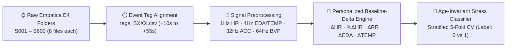
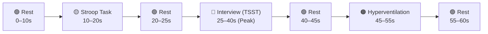

&lt;=&quot;&quot;&gt;

# 🧠 Synthetic Stress-Predict Dataset (`S001`–`S600`)

### *Age-Stratified, Empatica E4-Compatible Physiological Stress Benchmark for Personalized Baseline-Delta (`Δ`) Modeling*

[](https://github.com/italha-d/Stress-Predict-Dataset)
[](https://github.com/italha-d/Stress-Predict-Dataset)
[](#)
[](#)
[](#)
[](#)

*Modeled structurally after the open-access [Stress-Predict-Dataset](https://github.com/italha-d/Stress-Predict-Dataset) (Iqbal et al., Sensors, 2022) · Scaled to 600 age-calibrated synthetic subjects spanning ages 6–85.*

&lt;/div&gt;

---

### ⚡ At-a-Glance Snapshot

| Metric | Specification | Metric | Specification |
| :--- | :--- | :--- | :--- |
| **Total Participants** | `600` (`S001`–`S600`) | **Age Span** | `6` – `85` years (6 balanced cohorts) |
| **Class Balance** | Exact `50% / 50%` (`300` Baseline / `300` Stress) | **Gender Balance** | Exact `50% / 50%` (`300` Male / `300` Female) |
| **Processed Table** | `600 × 17` (`0` missing values, UTF-8-SIG) | **Raw Sensor Files** | `4,800` Empatica E4 CSV/TXT files (`6.39 MB` zipped) |
| **Primary Modalities** | `HR`, `RR`, `BVP`, `IBI`, `EDA`, `TEMP`, `ACC` | **Determinism** | Fixed NumPy `default_rng` seeds (`42` & `2026`) |

> [!WARNING]
> **Synthetic Data & Clinical Ethics Notice**
> Every physiological signal, questionnaire score, and participant record in this repository is **programmatically simulated** using fixed random seeds for engineering reproducibility. This repository contains **zero real human or clinical patient data** and **zero protected health information (PHI)**. It must **never** be used for clinical validation, medical diagnosis, or regulatory submissions—use it strictly for ML pipeline prototyping, ETL stress-testing, baseline-delta (`Δ`) feature validation, and educational benchmarks.

---

## 🎯 Why This Dataset Exists: The Cross-Age Baseline Trap

Most naive wearable stress classifiers rely on **global physiological cutoffs** (for example, flagging `HR > 85 bpm` as stressed). While that shortcut can look deceptively strong on homogeneous adult-only pilot datasets, it breaks down immediately across a multi-age population:

> [!IMPORTANT]
> **The Age-Inversion Paradox Observed in This Dataset**
> * A calm, resting **Kid (6–12 yrs)** averages **`90.56 bpm`** at baseline.
> * A stressed **Senior Citizen (60–85 yrs)** during an acute interview stressor averages **`81.58 bpm`**.
>
> Any model trained on raw `HR` or `RR` alone will systematically misclassify **calm children as stressed** and **stressed seniors as calm**.

This dataset is deliberately calibrated across six life-stage cohorts so engineers can prove and benchmark why **personalized baseline-delta features** (`ΔHR = Task_HR - Baseline_HR`, `ΔRR = Stress_RR - Baseline_RR`, and per-subject relative change `%ΔHR`) outperform raw thresholds across age groups.

---

## 🗺️ System & Signal Pipeline Architecture



### ⏱️ 60-Second Synthetic Stressor Protocol (`HR.csv` & `tags_<ID>.csv`)



---

## 🏗️ Repository Layout

Lightweight enough (`6.39 MB` zipped, `4,802` files total) for standard GitHub hosting—**no Git LFS required**.

```text
stress-predict-synthetic-600/
├── 📄 README.md                                          # Documentation, schema & benchmarks
├── 📊 Processed_data/
│   └── synthetic_stress_predict_600_participants.csv     # 600 rows × 17 exact columns (UTF-8-SIG)
└── 📁 Raw_data/
    ├── 📂 S001/                                          # Men cohort (S001–S100)
    │   ├── ACC.csv                                       # 3-axis accelerometer (32 Hz, 30s → 960 rows)
    │   ├── BVP.csv                                       # Blood Volume Pulse / PPG (64 Hz, 30s → 1,920 rows)
    │   ├── EDA.csv                                       # Electrodermal Activity (4 Hz, 60s → 240 rows)
    │   ├── HR.csv                                        # Heart Rate (1 Hz, 60s → 60 rows)
    │   ├── IBI.csv                                       # Inter-Beat Intervals (event-driven)
    │   ├── TEMP.csv                                      # Peripheral Skin Temp (4 Hz, 60s → 240 rows)
    │   ├── tags_S001.csv                                 # 6 Unix event timestamps
    │   └── info.txt                                      # Sensor sampling-rate metadata
    ├── 📂 S101/ ... S200/                                # Women cohort
    ├── 📂 S201/ ... S300/                                # Boys (Teens) cohort
    ├── 📂 S301/ ... S400/                                # Girls (Teens) cohort
    ├── 📂 S401/ ... S500/                                # Senior Citizens (60–85 yrs) cohort
    └── 📂 S501/ ... S600/                                # Kids (6–12 yrs) cohort
```

---

## 📊 Cohort Stratification & Verified Vital-Sign Summary

Every cohort has exactly **100 synthetic participants** and an exact **50 / 50 binary class split** (`50` baseline `Label=0`, `50` stressed `Label=1`).

| Cohort | ID Range | `n` | Age (yrs) | Gender Split | Resting HR (bpm) | Resting RR (brpm) | Interview HR (bpm) | Mean `ΔHR` (bpm) | Stressed (`1`) |
| :--- | :--- | ---: | :--- | :--- | ---: | ---: | ---: | ---: | ---: |
| 👨 **Men** | `S001`–`S100` | 100 | 20–59 | 100% Male | `70.71` | `14.73` | `86.26` | `+15.55` | 50 |
| 👩 **Women** | `S101`–`S200` | 100 | 21–59 | 100% Female | `73.33` | `15.24` | `88.75` | `+15.42` | 50 |
| 👦 **Boys (Teens)** | `S201`–`S300` | 100 | 13–19 | 100% Male | `77.22` | `16.58` | `93.37` | `+16.15` | 50 |
| 👧 **Girls (Teens)** | `S301`–`S400` | 100 | 13–19 | 100% Female | `79.17` | `16.76` | `94.69` | `+15.52` | 50 |
| 👴 **Senior Citizens** | `S401`–`S500` | 100 | 60–85 | 50% M / 50% F | `69.50` | `15.65` | `81.58` | `+12.08` | 50 |
| 🧒 **Kids** | `S501`–`S600` | 100 | 6–12 | 50% M / 50% F | `90.56` | `19.90` | `107.05` | `+16.49` | 50 |
| **🌐 Overall** | **`S001`–`S600`** | **600** | **6–85** | **50% M / 50% F** | **`76.75`** | **`16.48`** | **`91.95`** | **`+15.20`** | **300** |

> [!NOTE]
> Consistent with the original [Stress-Predict study (Sensors, 2022)](https://www.mdpi.com/1424-8220/22/21/8135), the **Interview** session produces the strongest autonomic surge, followed by **Hyperventilation** and the **Stroop Color-Word Test**. Senior Citizens use an attenuated reactivity scale (`0.80×`) to reflect age-related reduction in maximum heart rate reserve.

---

## 🗂️ Processed Schema: 17-Column Data Dictionary

File: `Processed_data/synthetic_stress_predict_600_participants.csv`

&lt;details open&gt;
&lt;summary&gt;&lt;b&gt;Click to expand / collapse full 17-column schema specification&lt;/b&gt;&lt;/summary&gt;

| `#` | Column Name | Dtype | Unit / Range | Engineering & Physiological Semantics |
| ---: | :--- | :--- | :--- | :--- |
| 1 | `Participant_ID` | `string` | `S001`–`S600` | Primary key; maps 1-to-1 to `Raw_data/<Participant_ID>/`. |
| 2 | `Assigned Name` | `string` | `Synthetic_<Cohort>_<NNN>` | Explicit synthetic identifier (e.g., `Synthetic_Kid_042`) for instant cohort grouping. |
| 3 | `Age` | `int` | `6`–`85` yrs | Integer age sampled uniformly within each cohort bracket. |
| 4 | `Gender` | `string` | `Male` / `Female` | Balanced 50/50 within `Senior` and `Kid` cohorts. |
| 5 | `PSS Score (0-40)` | `int` | `0`–`40` | Simulated Perceived Stress Scale; elevated distribution for `Label=1`. |
| 6 | `STAI-State (20-80)` | `int` | `20`–`80` | Simulated State Anxiety score during acute session. |
| 7 | `STAI-Trait (20-80)` | `int` | `20`–`80` | Simulated Trait Anxiety baseline correlated with `PSS` and `STAI-State`. |
| 8 | `HR` | `float` | `bpm` | Age-calibrated resting baseline heart rate. |
| 9 | `Stroop HR (bpm)` | `float` | `bpm` | Heart rate during Stroop Color-Word cognitive stressor. |
| 10 | `Interview HR (bpm)` | `float` | `bpm` | Heart rate during social-evaluative interview stressor (peak reactivity). |
| 11 | `Hyperventilation HR (bpm)` | `float` | `bpm` | Heart rate during hyperventilation provocation session. |
| 12 | `RR` | `float` | `brpm` | Age-calibrated resting baseline respiratory rate. |
| 13 | `Stress Resp Rate (brpm)` | `float` | `brpm` | Elevated respiratory rate under acute stress induction. |
| 14 | `Mean EDA (μS)` | `float` | `μS` | Mean electrodermal conductance; rises under sympathetic arousal. |
| 15 | `Skin Temp (°C)` | `float` | `°C` | Mean peripheral wrist skin temperature; slight vasoconstriction drop under stress. |
| 16 | `Label` | `int` | `0` or `1` | Binary classification target (`0` = Baseline / Rest, `1` = Stressed). |
| 17 | `Time` | `string` | `YYYY-MM-DD HH:MM:SS` | Session start timestamp (15-minute sequential spacing from `2026-11-01 09:00:00`). |

&lt;/details&gt;

---

## ⌚ Raw Sensor Specification (Empatica E4 Drop-In Format)

Every folder in `Raw_data/S001/`–`Raw_data/S600/` follows the standard **Empatica E4 CSV wire format**:
* **Line 1:** Session start timestamp in UTC Unix epoch seconds.
* **Line 2:** Sampling rate in Hz (omitted in event-driven `IBI.csv` and `tags_<ID>.csv`).
* **Line 3+:** Raw sensor readings.

| File | Rate | Duration | Samples | Columns | Calibration Details |
| :--- | ---: | ---: | ---: | :--- | :--- |
| `HR.csv` | `1.0 Hz` | `60 s` | `60` | `bpm` | 7-segment protocol timeline aligned to `tags_<ID>.csv`. |
| `EDA.csv` | `4.0 Hz` | `60 s` | `240` | `μS` | Centered on participant's `Mean EDA (μS)` with physiological jitter. |
| `TEMP.csv` | `4.0 Hz` | `60 s` | `240` | `°C` | Centered on participant's `Skin Temp (°C)` (`±0.08 °C` noise). |
| `BVP.csv` | `64.0 Hz` | `30 s` | `1,920` | PPG | Dual-harmonic PPG waveform frequency-locked to subject HR. |
| `ACC.csv` | `32.0 Hz` | `30 s` | `960` | `x, y, z` | Triaxial acceleration in `1/64 g` units (`z ≈ 64` at rest). |
| `IBI.csv` | Event | `60 s` | `~60–110` | `offset, ibi` | Beat-to-beat intervals derived from `60 / HR` with `~4%` HRV variance. |
| `tags_<ID>.csv` | Event | `60 s` | `6` | `unix_ts` | Start/end markers at `+10s, +20s, +25s, +40s, +45s, +55s`. |
| `info.txt` | — | — | — | Plain text | Sampling rate manifest & synthetic disclaimer. |

---

## 🚀 Quickstart & Production Code Examples

### 1️⃣ Load & Verify Processed Data

```python
import pandas as pd

df = pd.read_csv("Processed_data/synthetic_stress_predict_600_participants.csv")

assert df.shape == (600, 17), f"Unexpected shape: {df.shape}"
assert df.isna().sum().sum() == 0, "Found unexpected NaNs"

df["Cohort"] = df["Assigned Name"].str.split("_").str[1]
print(df.groupby("Cohort")[["Age", "HR", "Interview HR (bpm)", "RR"]].mean().round(2))
```

&lt;details&gt;
&lt;summary&gt;&lt;b&gt;2️⃣ Drop-In Empatica E4 Raw Sensor Loader (Python)&lt;/b&gt;&lt;/summary&gt;

```python
from pathlib import Path
import pandas as pd

def load_e4_signal(csv_path: str | Path, col_names: list[str]) -> pd.DataFrame:
    """Parse an Empatica E4 CSV (row 0 = Unix start time, row 1 = sample rate Hz)."""
    with open(csv_path, "r", encoding="utf-8") as f:
        start_ts = float(f.readline().strip().split(",")[0])
        sample_rate = float(f.readline().strip().split(",")[0])

    data = pd.read_csv(csv_path, skiprows=2, header=None, names=col_names)
    offsets = pd.to_timedelta(data.index / sample_rate, unit="s")
    data.index = pd.to_datetime(start_ts, unit="s", utc=True) + offsets
    return data

hr_df = load_e4_signal("Raw_data/S001/HR.csv", ["HR_bpm"])
acc_df = load_e4_signal("Raw_data/S001/ACC.csv", ["acc_x", "acc_y", "acc_z"])
print(hr_df.head())
```

&lt;/details&gt;

&lt;details&gt;
&lt;summary&gt;&lt;b&gt;3️⃣ Age-Invariant Baseline-Delta (&lt;code&gt;Δ&lt;/code&gt;) Benchmark (Scikit-Learn)&lt;/b&gt;&lt;/summary&gt;

```python
import pandas as pd
from sklearn.ensemble import RandomForestClassifier
from sklearn.model_selection import StratifiedKFold, cross_val_score

df = pd.read_csv("Processed_data/synthetic_stress_predict_600_participants.csv")

# Personalized baseline-delta features neutralize age-driven resting offsets
df["delta_stroop_hr"] = df["Stroop HR (bpm)"] - df["HR"]
df["delta_interview_hr"] = df["Interview HR (bpm)"] - df["HR"]
df["delta_hypervent_hr"] = df["Hyperventilation HR (bpm)"] - df["HR"]
df["delta_rr"] = df["Stress Resp Rate (brpm)"] - df["RR"]
df["pct_interview_hr"] = df["delta_interview_hr"] / df["HR"]

features = [
    "delta_stroop_hr",
    "delta_interview_hr",
    "delta_hypervent_hr",
    "delta_rr",
    "pct_interview_hr",
    "Mean EDA (μS)",
    "Skin Temp (°C)",
]

cv = StratifiedKFold(n_splits=5, shuffle=True, random_state=42)
clf = RandomForestClassifier(n_estimators=200, random_state=42, n_jobs=-1)
scores = cross_val_score(clf, df[features], df["Label"], cv=cv, scoring="f1")
print(f"5-Fold Stratified F1 (Delta Features): {scores.mean():.4f} ± {scores.std():.4f}")
```

&lt;/details&gt;

---

## 📦 Publishing to GitHub

> [!TIP]
> Because the entire archive is only **6.39 MB** compressed, you can commit and push directly to GitHub without configuring Git LFS.

```bash
unzip synthetic_stress_predict_raw_data_S001_S600.zip -d stress-predict-synthetic-600
cd stress-predict-synthetic-600

# Keep local Python & OS artifacts out of version control
printf "__pycache__/\n*.pyc\n.DS_Store\n.venv/\n.ipynb_checkpoints/\n" > .gitignore

git init -b main
git add .
git commit -m "feat: add 600-participant age-calibrated synthetic Stress-Predict dataset (S001-S600)"
git remote add origin https://github.com/<your-username>/<your-repo>.git
git push -u origin main
```

---

## 📚 References & Open-Access Real Datasets

If you reference the original Empatica E4 stress protocol or pair this synthetic benchmark with genuine human recordings, cite and explore these real open-access repositories:

* **Original Protocol & Reference Schema:** Talha Iqbal et al. (2022), *Stress Monitoring Using Wearable Sensors: A Pilot Study and Stress-Predict Dataset*, **Sensors**, 22(21), 8135 — [MDPI Paper](https://www.mdpi.com/1424-8220/22/21/8135) · [GitHub Repo](https://github.com/italha-d/Stress-Predict-Dataset)
* **Companion Real Open-Access Datasets:** [WESAD (UCI)](https://archive.ics.uci.edu/dataset/465/wesad+wearable+stress+and+affect+detection) · [PhysioNet Wearable Stress & Exercise](https://physionet.org/content/wearable-device-dataset/) · [CATSA (Mendeley Data)](https://data.mendeley.com/datasets/jwbz4ggws5)

&lt;details&gt;
&lt;summary&gt;&lt;b&gt;📋 BibTeX Citation (Original Stress-Predict Paper)&lt;/b&gt;&lt;/summary&gt;

```bibtex
@article{iqbal2022stress,
  title   = {Stress Monitoring Using Wearable Sensors: A Pilot Study and Stress-Predict Dataset},
  author  = {Iqbal, Talha and Simpkin, Andrew J. and Roshan, Davood and Glynn, Nicola and Killilea, John and Walsh, Jane and Molloy, Gerard and Ganly, Sandra and Ryman, Hannah and Coen, Eileen and Elahi, Adnan and Wijns, William and Shahzad, Atif},
  journal = {Sensors},
  volume  = {22},
  number  = {21},
  pages   = {8135},
  year    = {2022},
  doi     = {10.3390/s22218135}
}
```

&lt;/details&gt;

---

&lt;div align=&quot;center&quot;&gt;

### ⚖️ License

Released under the **MIT License** · Free to use, modify, and redistribute with attribution and retention of the synthetic data disclaimer.

&lt;/div&gt;
