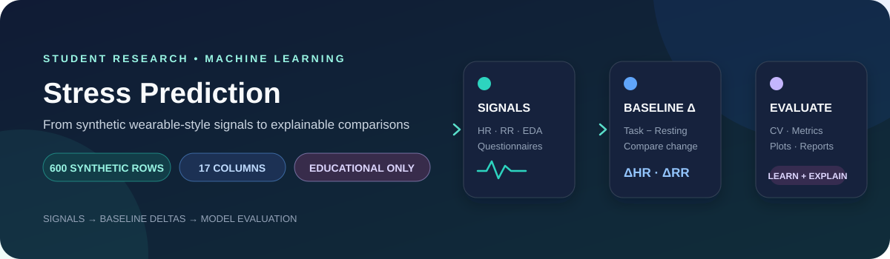

<div align="center">

# Stress Prediction Lab

### A visual, student-friendly tour of synthetic stress classification

[](https://colab.research.google.com/github/Ayyano/Stress-Predict-Dataset-by-Ayano/blob/main/finally.ipynb)
[](./finally.ipynb)


<br />

<a href="./finally.ipynb"></a>

**Understand the full journey:** data → features → models → evidence → explanation.

</div>

> [!IMPORTANT]
> **Educational use only.** The included data is synthetic—not collected from real people. This project is not a medical device or diagnostic tool, and its model scores are not evidence of clinical performance.

## ✨ Explore the project

| 01 · Learn | 02 · Explore | 03 · Reproduce |
|---|---|---|
| [Research notebook](./finally.ipynb) | [600-row dataset](./synthetic_stress_predict_600_participants.csv) | [Open in Google Colab](https://colab.research.google.com/github/Ayyano/Stress-Predict-Dataset-by-Ayano/blob/main/finally.ipynb) |
| Step-by-step analysis, visualizations, and model comparisons | 17 columns of synthetic participant records | Run the notebook without a local setup |

**Also in the repository:** [Raw-data archive](./synthetic_stress_predict_raw_data_S001_S600.zip) · [Supplementary dashboard/report source](./live%20preview%20and%20download%20clinical%20pdfs%20reports)

## 🧭 The research journey

```mermaid
%%{init: {"theme":"base","themeVariables":{"primaryColor":"#ecfeff","primaryTextColor":"#0f172a","primaryBorderColor":"#0f766e","lineColor":"#64748b","secondaryColor":"#eff6ff","tertiaryColor":"#f5f3ff","fontFamily":"ui-sans-serif, system-ui, sans-serif"}}}%%
flowchart LR
    A["📥 01 · Load<br/>600 synthetic rows"] --> B["🔎 02 · Inspect<br/>labels & quality"]
    B --> C["🧹 03 · Prepare<br/>missingness & outliers"]
    C --> D["🧮 04 · Engineer<br/>baseline-relative Δ"]
    D --> E["🧪 05 · Validate<br/>stratified splits & CV"]
    E --> F["🌲 06 · Compare<br/>models & ensembles"]
    F --> G["📊 07 · Explain<br/>metrics & figures"]
    G --> H["📄 08 · Share<br/>tables & reports"]
    classDef data fill:#ecfeff,stroke:#0f766e,color:#134e4a,stroke-width:2px
    classDef model fill:#eff6ff,stroke:#2563eb,color:#1e3a8a,stroke-width:2px
    classDef explain fill:#f5f3ff,stroke:#7c3aed,color:#4c1d95,stroke-width:2px
    class A,B,C data
    class D,E,F model
    class G,H explain
```



<details>
<summary><strong>💡 What happens at each step?</strong></summary>
<br />

1. **Load & inspect** — Find the target and signals; examine labels and data quality.
2. **Prepare** — Handle missing values and review outliers before modeling.
3. **Engineer** — Express task response relative to resting measurements.
4. **Validate** — Use stratified train/test splits and cross-validation.
5. **Compare** — Evaluate several classifiers, tuned models, and ensembles.
6. **Explain** — Compare metrics, error patterns, feature importance, and ablations.
7. **Share** — Review the generated figures, result tables, and report outputs.

</details>

## 📡 Dataset at a glance

<div align="center">

| **600** records | **17** columns | **2** target classes | **Synthetic** data |
|:---:|:---:|:---:|:---:|
| One record per generated participant | Biomarkers, scores & metadata | `0` baseline · `1` stressed | For study and demonstration |

</div>

<details>
<summary><strong>🗂️ Open the data dictionary</strong></summary>
<br />

| Column | Meaning |
|---|---|
| `Participant_ID` | Generated participant identifier |
| `Assigned Name` | Generated name/group label; not a real identity |
| `Age`, `Gender` | Demographic fields in the synthetic record |
| `PSS Score (0-40)` | Perceived Stress Scale-style score |
| `STAI-State (20-80)` | State anxiety-style score |
| `STAI-Trait (20-80)` | Trait anxiety-style score |
| `HR` | Resting heart rate (beats per minute) |
| `Stroop HR (bpm)` | Heart rate during the Stroop task |
| `Interview HR (bpm)` | Heart rate during the interview task |
| `Hyperventilation HR (bpm)` | Heart rate during the hyperventilation task |
| `RR` | Resting respiratory rate |
| `Stress Resp Rate (brpm)` | Respiratory rate during a task condition |
| `Mean EDA (μS)` | Mean electrodermal activity (microsiemens) |
| `Skin Temp (°C)` | Skin temperature in degrees Celsius |
| `Label` | Binary target: `0` = baseline/normal, `1` = stressed |
| `Time` | Generated timestamp metadata |

**Student note:** IDs, names, and timestamps are metadata, not physiological signals. Check the notebook's selected features before training; never assume every column belongs in the model.

</details>

## 🧠 The key idea · compare change, not just level

A baseline-relative feature asks: **“How did this signal change from rest?”**

<div align="center">

| Resting value | Task value | Baseline-relative feature |
|:---:|:---:|:---:|
| Resting HR | Interview HR | **ΔInterview HR = Interview HR − Resting HR** |
| Resting RR | Task respiratory rate | **ΔRR = Task RR − Resting RR** |

</div>

This reframes the model input around **individual change** rather than only the absolute measurement. It is an educational feature-engineering idea—not a validated clinical indicator.

## 📈 Models & evidence

The notebook compares raw-baseline and engineered-feature tracks, then evaluates classifiers and ensemble approaches. Results are presented with multiple views so one number does not tell the whole story.

| Metric | The question it answers |
|---|---|
| **Accuracy** | What fraction of predictions were correct? |
| **Precision** | Of records predicted stressed, how many were labeled stressed? |
| **Recall** | Of stressed-labeled records, how many did the model find? |
| **F1** | How do precision and recall balance together? |
| **ROC-AUC** | How well are the two classes ranked across thresholds? |
| **Confusion matrix** | Which kinds of predictions were correct or incorrect? |

**Notebook views include:** stratified cross-validation · 70/30 and 80/20 comparisons · feature ablation · feature importance · ROC curves · confusion matrices · cohort-level checks.

> **Interpret results carefully.** Synthetic labels and features can have simple relationships that real-world data does not. High benchmark scores here do not show that a model can detect stress in people. Real research requires validated measures, independent participants, leakage checks, consent, and appropriate oversight.

## 🚀 Run it

### Fastest route · Google Colab

1. Open [`finally.ipynb`](./finally.ipynb) in Colab using the button above.
2. Confirm the project CSV is available in the runtime. The notebook searches for a local CSV and includes a synthetic-data fallback.
3. Run cells from top to bottom; model searches may take several minutes.
4. Review the charts and tables in the notebook. Outputs are saved under `/content/results` in Colab.

### Local Jupyter

```bash
python -m pip install numpy pandas matplotlib seaborn scipy scikit-learn xgboost lightgbm reportlab dash plotly openpyxl jupyter
jupyter notebook finally.ipynb
```

Run the cells in order. Outside Colab, the notebook uses `./results` for generated outputs. Some optional report/dashboard sections may need additional environment setup described in their notebook cells.

## 🎨 What you can present

| Visual / output | Use it to explain… |
|---|---|
| Workflow diagram | The sequence from data checks to evaluation |
| Feature-space and cohort plots | How engineered signals compare across labels/groups |
| Ablation and feature-importance charts | Whether feature groups affect model results |
| ROC curve and confusion matrix | Ranking quality and prediction errors |
| Result tables and PDF outputs | The findings in a presentation-friendly format |

Exact output names and scores may change with the notebook version, data, and package versions. Use the generated notebook outputs as the source of truth.

<details>
<summary><strong>🗣️ Student presentation cheat sheet</strong></summary>
<br />

1. **Question:** Can baseline-relative signals help classify this synthetic label?
2. **Data:** What does one row represent? Why is the dataset synthetic?
3. **Method:** How were features created, and how was validation performed?
4. **Evidence:** What do precision, recall, and the confusion matrix add beyond accuracy?
5. **Limitations:** What could make synthetic-data results fail to generalize?
6. **Next step:** What independent, ethically collected data would test the idea?

</details>

## 🧪 Reproducibility checklist

- Record the notebook version, dataset file, package versions, split strategy, and metrics.
- Keep test data out of model selection; do not tune against the final test results.
- Check whether any input feature is derived from, or directly encodes, the target.
- Treat every generated score as an experiment result, not a clinical claim.

## 📁 Repository map

```text
.
├── assets/
│   └── stress-project-banner.svg
├── finally.ipynb
├── readme.md
├── synthetic_stress_predict_600_participants.csv
├── synthetic_stress_predict_raw_data_S001_S600.zip
└── live preview and download clinical pdfs reports
```

<div align="center">

**Built for learning, visual explanation, and reproducible exploration.**

[⬆ Back to top](#stress-prediction-lab)

</div>
